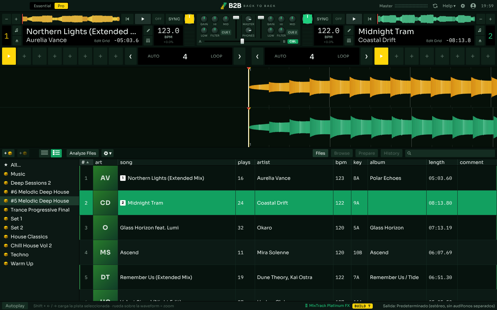

# B2B · Back to back

App de escritorio para mezclar música, hecha con React + Electron. Lee tu librería
de Serato sin modificarla y funciona con la Numark Mixtrack Platinum FX.



## Qué hace

- **Lee tu librería de Serato** (solo lectura): base de datos, crates, hot cues y
  beatgrid salen de `~/Music/_Serato_` y de los tags de tus archivos. B2B nunca
  escribe en ellos; los cues que creas acá se guardan aparte.
- **Audio con Web Audio**: play, pitch, SYNC con BPM y fase, auto loop cuantizado
  al grid, hot cues, scratch con AudioWorklet.
- **Mixer** de 2 canales: gain, EQ de 3 bandas, filtro, faders, crossfader y CUE
  por canal.
- **Waveforms en 3 bandas**, dibujadas sobre el beatgrid. Si una pista no trae BPM
  ni grid, los detecta sola.
- **Salida en 4 canales**: con la Mixtrack, el master va por los canales 1-2 y los
  audífonos (CUE) por los 3-4.
- **Controlador**: mapeo completo de la Numark Mixtrack Platinum FX, con LEDs,
  vúmetros y las pantallas de los jogs.

## Requisitos

- macOS (probado en un MacBook Pro 2017)
- [Node.js](https://nodejs.org) 20 o superior
- Opcional: Numark Mixtrack Platinum FX

## Cómo correrla

```bash
git clone https://github.com/TU-USUARIO/b2b.git
cd b2b
npm install
npm run dev
```

La primera vez, abre ⚙︎ Ajustes y apunta las dos rutas: tu carpeta de música y tu
carpeta `_Serato_`.

Otros comandos:

- `npm run web`: la interfaz en el navegador, sin acceso a tus archivos
- `npm start`: compila y abre la versión final

## Controlador: Numark Mixtrack Platinum FX

Se conecta solo al abrir la app. El estado aparece abajo a la derecha y en Ajustes,
donde además hay un monitor MIDI para ver los mensajes en crudo.

| Control | Qué hace |
|---|---|
| PLAY / CUE | Play-pausa. CUE: sonando vuelve al cue y pausa; en pausa fija el cue; sobre el cue lo escuchas mientras lo sostienes |
| SHIFT + PLAY / SHIFT + CUE | Stutter desde el cue / ir al inicio |
| SYNC (SHIFT + SYNC) | Sincroniza BPM y fase (lo apaga) |
| Jog, parte de arriba | Scratch (el botón SCRATCH lo activa o desactiva) |
| Jog, borde | Empuja o frena para cuadrar beats. Con SHIFT: búsqueda rápida |
| Fader de pitch | ±8 %. SHIFT + PITCH BEND − cambia el rango (8/16/50 %) |
| PITCH BEND + / − | Acelera o frena mientras lo sostienes. SHIFT + BEND + = key lock |
| Pads – HOT CUE | Saltar y reproducir / guardar. SHIFT + pad = borrar |
| Pads – AUTO LOOP | Loops de 1/8 a 16 beats |
| Pads – FADER CUTS | Los pads 1-4 cortan el canal mientras los sostienes |
| LOOP, ½, ×2 | Auto loop, mitad, doble. SHIFT + ½ / ×2 = loop in / loop out |
| Mixer | Gain, EQ, filtro, volumen, crossfader, CUE, cue mix y master |
| BROWSE | Girar: moverse por la lista. Presionar: cambiar entre crates y pistas. LOAD 1/2 carga |

**El fader de pitch tiene soft takeover**: no toma el control hasta que su posición
física coincide con el pitch actual, para que el tema no pegue un salto. Mientras
espera, el porcentaje parpadea en amarillo.

**Las pantallas de los jogs necesitan permiso de SysEx**, que el sistema solo
concede a partir de un clic. Si salen en blanco o el controlador se pone a hacer su
show de luces (modo demo), abre ⚙︎ Ajustes → Controlador y aplasta "Activar
pantallas del jog".

## Falta

- Efectos (botones y palancas de FX)
- Sampler
- Key lock real: hoy el pitch también cambia el tono

## Créditos y licencia

El mapeo MIDI de la Mixtrack Platinum FX (números de los controles, formato de las
pantallas de los jogs) está basado en el mapeo abierto de
[Mixxx](https://github.com/mixxxdj/mixxx), que es software libre bajo GPL-2.0+.
Por eso B2B se publica bajo la misma licencia: **GPL-2.0-or-later** (ver
[LICENSE](LICENSE)). Gracias al equipo de Mixxx y a quienes documentaron este
controlador.

Tipografías: [Sora](https://fonts.google.com/specimen/Sora) e
[IBM Plex Mono](https://fonts.google.com/specimen/IBM+Plex+Mono), ambas bajo
SIL Open Font License.

## Aviso

B2B es un proyecto independiente, sin relación ni respaldo de Serato ni de Numark.
Lee los archivos de Serato en modo solo lectura mediante formatos documentados
públicamente; "Serato" y "Numark" son marcas de sus respectivos dueños y se
mencionan solo para describir con qué funciona.
